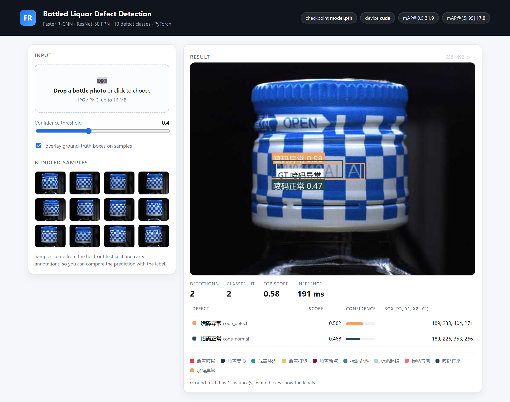
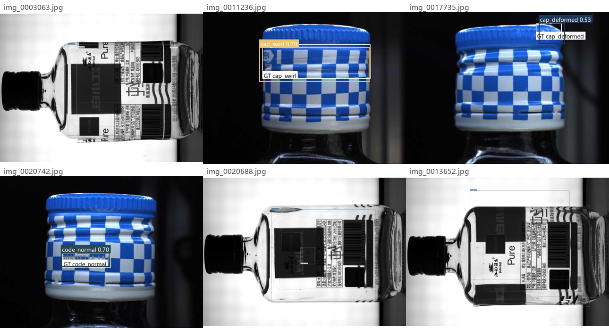
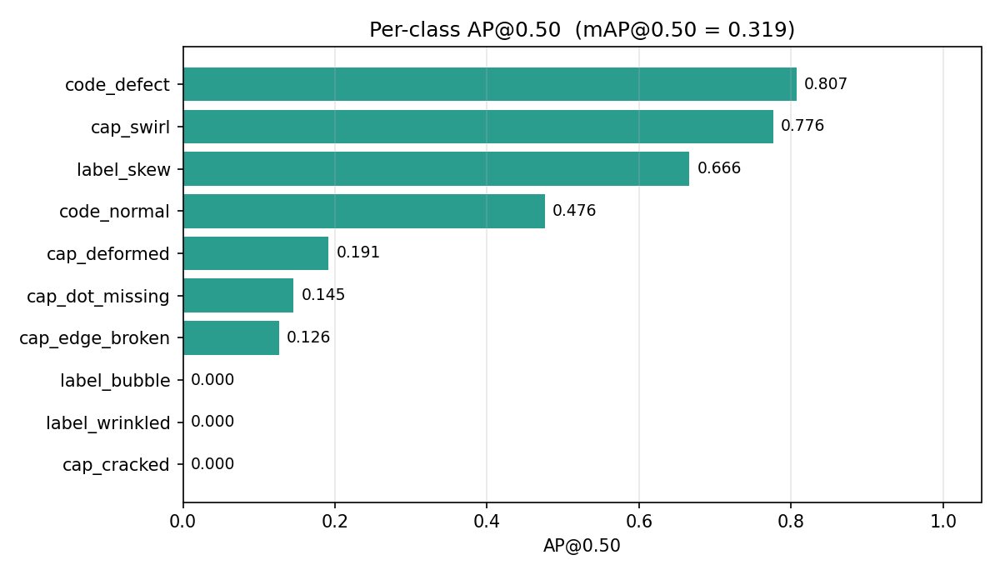
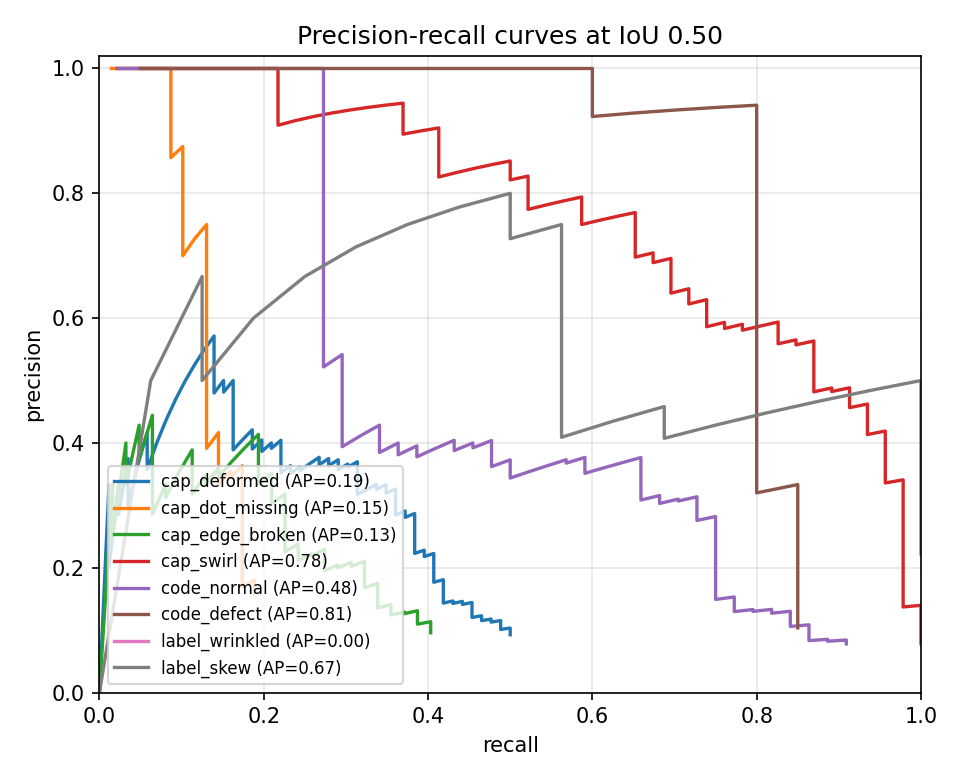
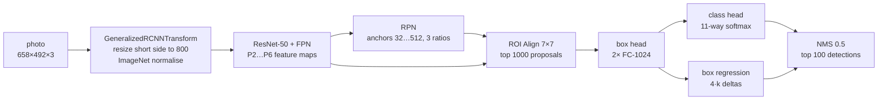

<div align="right">

**English** · [简体中文](README.zh-CN.md)

</div>

# Bottled Liquor Defect Detection with Faster R-CNN


Object detection for **bottled Chinese liquor (baijiu) surface defects** on a
production line: cracked / deformed caps, broken cap edges, skewed or wrinkled
labels, air bubbles under the label, and normal vs. misprinted inkjet codes.

The detector is Faster R-CNN with a ResNet-50 + FPN backbone (41.1 M parameters),
fine-tuned from the COCO checkpoint with `torchvision`. This repository contains
the **complete, runnable pipeline** - data splits, training, a dependency-free
COCO mAP evaluation, visualisation, batch inference and a web demo - plus the
**measured** results of the released checkpoint on a held-out test split.

[Overview](#-overview) · [Results](#-results) · [Dataset](#-dataset) · [Quick start](#-quick-start) · [CLI reference](#-cli-reference) · [How it works](#-how-it-works) · [Notes & FAQ](#-reproducibility-notes)

---

## 🔍 Overview

Manual visual inspection is the bottleneck on a high-speed filling line: a human
checker sees a bottle for a fraction of a second, and defect classes such as
"cap cracked" and "cap edge broken" are visually adjacent. This project asks a
standard two-stage detector to localise and classify **10 defect categories** in
a single forward pass.

| | |
|---|---|
| **Task** | Multi-class object detection (localisation + classification) |
| **Model** | Faster R-CNN, ResNet-50 + FPN backbone, 41.1 M params |
| **Input** | 658 × 492 RGB photos, resized to 800 px short side |
| **Classes** | 10 defect categories + 1 reserved background slot |
| **Dataset** | 4,516 images / 6,945 bounding boxes (70 / 20 / 10 split) |
| **Framework** | PyTorch 2.2 · torchvision 0.17 · Python 3.8+ |
| **Reference hardware** | NVIDIA RTX 3050 Laptop (4 GB), CUDA 12.1 |
| **Test mAP@0.50** | **0.319** · mAP@[.50:.95] 0.170 · 138 ms/image |

---

## 🖼 Demo

The web demo answers two questions: *"what is wrong with this bottle"* and
*"is the prediction actually right"* - sample photos carry their ground-truth
boxes, so predictions and labels can be compared side by side.



```bash
python app/app.py --port 5000     # then open http://127.0.0.1:5000
```

Predictions on held-out test images (coloured = predicted, white = ground truth):



---

## 📊 Results

Everything below was produced by `src/evaluate.py` on the **452-image test split**,
which was never used during training. Regenerate with one command:

```bash
python -m src.evaluate --checkpoint saved_models/model.pth \
    --output-dir outputs/eval_checkpoint --save-predictions
```

### Aggregate

| Metric | Value | Meaning |
|---|---|---|
| **mAP@0.50** | **0.319** | mean AP over the 10 classes at IoU 0.50 |
| mAP@0.75 | 0.156 | stricter localisation |
| mAP@[.50:.95] | 0.170 | COCO primary metric |
| Precision @ conf 0.50 | 0.630 | of 135 boxes the model reports, 85 are correct |
| Recall @ conf 0.50 | 0.155 | 85 of 549 annotated defects are found |
| F1 @ conf 0.50 | 0.249 | |
| Image-level exact match | 0.374 | share of photos whose predicted class set equals the label set |
| Inference speed | 138 ms/img | batch 1, RTX 3050 Laptop 4 GB, 452 images in 63 s |

The precision/recall split is the honest summary of this checkpoint: **when it
fires it is usually right, but it stays silent on most defects**. That is a
recall problem, not a localisation problem - see the per-class table.

### Per class



| # | Class | 中文 | Train | Val | Test | AP@0.50 | AP@[.50:.95] |
|---|---|---|---|---|---|---|---|
| 1 | `cap_cracked` | 瓶盖破损 | 1,135 | 334 | 150 | 0.000 | 0.000 |
| 2 | `cap_deformed` | 瓶盖变形 | 487 | 132 | 86 | 0.192 | 0.058 |
| 3 | `cap_edge_broken` | 瓶盖坏边 | 459 | 135 | 62 | 0.127 | 0.044 |
| 4 | `cap_swirl` | 瓶盖打旋 | 338 | 96 | 46 | 0.777 | 0.540 |
| 5 | `cap_dot_missing` | 瓶盖断点 | 422 | 123 | 69 | 0.145 | 0.025 |
| 6 | `label_skew` | 标贴歪斜 | 137 | 33 | 16 | 0.666 | 0.282 |
| 7 | `label_wrinkled` | 标贴起皱 | 296 | 70 | 18 | 0.000 | 0.000 |
| 8 | `label_bubble` | 标贴气泡 | 319 | 86 | 38 | 0.000 | 0.000 |
| 9 | `code_normal` | 喷码正常 | 344 | 101 | 44 | 0.476 | 0.234 |
| 10 | `code_defect` | 喷码异常 | 136 | 43 | 20 | 0.807 | 0.513 |

Read the table before trusting the aggregate number:

* **Three classes score exactly 0.000 with hundreds of ground-truth boxes**
  (`cap_cracked` 150, `label_wrinkled` 18, `label_bubble` 38). The checkpoint
  never emits a single box for them at any confidence - the cross-entropy head
  collapsed onto the visually dominant classes. COCO counts these as AP = 0;
  silently skipping them would have reported mAP@0.50 as **0.399** instead of
  the true 0.319.
* The classes that work (`code_defect` 0.807, `cap_swirl` 0.777, `label_skew`
  0.666) are the ones with high contrast against the bottle.
* Small, low-contrast defects at 658 × 492 px are near the resolution limit of
  the current input pipeline - raising `--min-size` to 1000+ is the first thing
  to try.

### Precision-recall curves



---

## 🗂 Dataset

4,516 images, 6,945 boxes, 10 defect classes, captured at 658 × 492 px.
The split is fixed and versioned in `data/annotations/` (seed 42):

| Split | Images | Boxes | Share |
|---|---|---|---|
| Train | 3,161 | 4,868 | 70 % |
| Validation | 903 | 1,405 | 20 % |
| Test | 452 | 672 | 10 % |

See **[data/README.md](data/README.md)** for the COCO schema, the image layout and
why the 260 MB image set is not committed (a 60-image class-balanced sample is).

Annotation quirks worth knowing:

* the files contain a real category with `category_id = 0` named `背景`
  ("background", 1,170 boxes). torchvision reserves label 0 for the background
  slot of the classifier, so those boxes can never be learned - they are excluded
  from every metric here;
* boxes are COCO-style `[x_min, y_min, width, height]`;
* some photos are stored rotated by 90°, which the augmentation pipeline tolerates
  but the demo makes obvious.

---

## 🚀 Quick start

### 1. Clone and install

```bash
git clone https://github.com/wushaw1102/Bottled-liquor-defect-detection-based-on-FasterR-CNN.git
cd Bottled-liquor-defect-detection-based-on-FasterR-CNN

python -m venv .venv
# Windows
.venv\Scripts\activate
# macOS / Linux
source .venv/bin/activate

# install the CUDA build that matches your driver (see pytorch.org)
pip install torch torchvision --index-url https://download.pytorch.org/whl/cu121
pip install -r requirements.txt
```

### 2. Check the environment

```bash
python -c "import torch, torchvision; print(torch.__version__, torchvision.__version__, torch.cuda.is_available())"
# 2.2.0+cu121 0.17.0+cu121 True
```

### 3. Verify the data

```bash
python scripts/prepare_dataset.py \
    --annotation-file data/annotations/instances_all.json \
    --image-dir data/images --verify-only
```

This prints the per-class histogram and reports missing images. Expect
`452 images | 672 annotations` for the test split and no `!!` lines.

> No `data/images` yet? The 60 committed sample photos live in
> `data/sample/images`; everything below accepts `--image-dir data/sample/images`
> and `--annotation-file data/sample/annotations.json` so you can rehearse the
> full workflow first.

### 4. Run inference on a photo

```bash
python -m src.predict --image data/sample/images/img_0026692.jpg --threshold 0.4
```

```
img_0026692.jpg               2 detections | code_defect(0.58), code_normal(0.47)
wrote outputs/predictions/detections.json
wrote outputs/predictions/detections.csv
```

Annotated images land in `outputs/predictions/`. Add `--chinese` for Chinese
labels, or `--input-dir` to sweep a folder.

### 5. Reproduce the benchmark

```bash
python -m src.evaluate --checkpoint saved_models/model.pth \
    --output-dir outputs/eval_checkpoint
```

Expected output:

```
mAP@[.50:.95] : 0.1697
mAP@0.50      : 0.3189
mAP@0.75      : 0.1565
P / R / F1 @ 0.5: 0.6296 / 0.1548 / 0.2485
```

The script needs no `pycocotools` - AP is computed in `src/metrics.py` with the
same 101-point interpolation COCO uses.

### 6. Regenerate every figure in this README

```bash
python -m src.visualize \
    --metrics outputs/eval_checkpoint/metrics.json \
    --checkpoint saved_models/model.pth \
    --output-dir docs/images --gallery-count 6 --montage
```

### 7. Train from scratch

```bash
python -m src.train --epochs 10 --batch-size 4 --lr 5e-4 --output-dir outputs/run1
```

On a 4 GB GPU the default batch size will not fit at 800 px; use

```bash
python -m src.train --epochs 10 --batch-size 2 --min-size 600 --workers 4
```

which measures **1.1 s/step ≈ 26 min/epoch ≈ 4.5 h for 10 epochs** on an
RTX 3050 Laptop. Training writes `best_model.pth` (lowest validation loss),
`last_model.pth`, `history.json` and `run_config.json` into `--output-dir`.

### 8. Evaluate your own checkpoint

```bash
python -m src.evaluate --checkpoint outputs/run1/best_model.pth --output-dir outputs/eval_run1
```

### 9. Launch the demo

```bash
python app/app.py --checkpoint outputs/run1/best_model.pth --port 5000
```

Upload a photo, drag one in, or click a bundled sample; move the confidence
slider to trade precision for recall; toggle the ground-truth overlay to judge a
prediction against its label.

---

## 🛠 CLI reference

| Command | What it does | Useful flags |
|---|---|---|
| `python -m src.train` | fine-tune from COCO weights | `--epochs --batch-size --lr --min-size --amp/--no-amp --patience --resume --limit-train` |
| `python -m src.evaluate` | COCO mAP + P/R/F1 + PR data | `--checkpoint --score-threshold --limit --save-predictions` |
| `python -m src.predict` | annotate images / export boxes | `--image --input-dir --threshold --chinese --json` |
| `python -m src.visualize` | AP bars, PR curves, gallery | `--metrics --history --checkpoint --montage` |
| `python app/app.py` | web demo | `--port --threshold --device --checkpoint` |
| `scripts/prepare_dataset.py` | split + verify a COCO file | `--train --val --seed --drop-background --verify-only` |
| `scripts/make_sample.py` | rebuild the committed sample | `--count --per-class` |

Both `src.train` and `src.evaluate` accept `--arch
fasterrcnn_mobilenet_v3_large_fpn`, a 4× lighter backbone that runs on CPU -
useful for a laptop or a container without a GPU.

---

## 📁 Project structure

```
.
├── src/                        importable package, no scripts-with-side-effects
│   ├── config.py               class table, paths, defaults (single source of truth)
│   ├── dataset.py              COCO dataset + box-aware augmentation
│   ├── model.py                Faster R-CNN factory, checkpoint loading
│   ├── metrics.py              dependency-free COCO AP / mAP / PR
│   ├── train.py                fine-tuning loop (AMP, early stopping, history)
│   ├── evaluate.py             benchmark a checkpoint, write metrics.json
│   ├── predict.py              single image / folder inference, CSV + JSON export
│   ├── visualize.py            box drawing, AP bars, PR curves, gallery montage
│   └── inference.py            Detector wrapper shared by CLI + demo
├── app/
│   ├── app.py                  Flask demo (upload, samples, threshold slider)
│   └── templates/index.html    self-contained UI, no CDN, no build step
├── scripts/
│   ├── prepare_dataset.py      split + integrity check
│   └── make_sample.py          build data/sample from the test split
├── data/
│   ├── annotations/            instances_{all,train,val,test}.json
│   ├── sample/                 60 photos + subset annotations
│   └── README.md               dataset layout and schema
├── docs/images/                figures used in this README (all generated)
├── saved_models/model.pth      released checkpoint (165 MB, Git LFS-free download)
├── legacy/original_scripts/    pre-refactor code, kept for provenance
└── outputs/                    training runs, metrics, predictions (git-ignored)
```

---

## 🧠 How it works



**Why a two-stage detector.** The defects share the same host object: a bottle
cap is either intact or cracked, and a label is either flat or wrinkled. A
one-stage detector has to sort that out in a single pass per anchor, whereas
Faster R-CNN first proposes regions (RPN), then takes a second, higher-resolution
look at each proposal through ROI Align and a 1024-d fully connected head. For
small, low-contrast regions - a 40 × 60 px crack next to a 100 px cap - that
second look pays for itself.

**Losses.** Classification cross-entropy + smooth-L1 box regression, applied
twice: once on the RPN proposals and once on the final head.

**How the metrics are computed** (`src/metrics.py`):

1. per image, per class, detections are sorted by score and matched greedily to
   the highest-IoU unmatched ground-truth box;
2. a match counts as a true positive when IoU ≥ threshold (0.50 … 0.95);
3. precision/recall are accumulated over the whole split, and AP is the
   101-point interpolated area under that curve;
4. mAP is the mean over the 10 classes; a class with ground truth but no
   detection scores 0, a class absent from the split is skipped.

---

## 🔬 Reproducibility notes

This is a rewrite of an earlier three-script version. The defects fixed here are
the reason the project could not be reproduced before, so they are documented
rather than hidden:

| Problem in the original code | Consequence | Fix |
|---|---|---|
| `transforms.RandomHorizontalFlip` / `RandomRotation` applied to the image only, boxes untouched | ~50 % of training samples had a box on the wrong half of the picture | augmentation in `src/dataset.py` mirrors the boxes with the image; rotation dropped (it needs box recomputation) |
| `transforms.Normalize` in the dataset **and** inside `GeneralizedRCNNTransform` | every input was normalised twice, pushing the backbone off the COCO distribution | dataset returns `[0, 1]`; the model normalises once. The released checkpoint was trained on double-normalised inputs, so `model.py` folds the second normalisation into the transform (exact to 2e-6) |
| `split_dataset()` wrote `"annotations": data['annotations']` into every split | val/test files referenced all 6,945 boxes while holding a third of the images: silent label leakage | `scripts/prepare_dataset.py` keeps images and boxes together and refuses to write an inconsistent split |
| no seed, `random.shuffle` without one | two runs produced different splits | seed 42 everywhere, splits committed to the repo |
| `image = cv2.cvtColor(cv2.imread(path), ...)` | hard dependency on OpenCV, crashes on a missing file | Pillow, plus a clear error and per-file validation |
| no validation metric, no best-checkpoint selection | the last epoch was kept no matter what | validation loss + `best_model.pth`, `history.json`, early stopping |
| loss/accuracy figures generated by two standalone scripts with hard-coded (and mutually inconsistent) series | the published curves did not correspond to any run | both scripts removed; every figure in this README is produced by `src/evaluate.py` + `src/visualize.py` from the checkpoint in this repository |

Two numbers in this README are therefore different from the previous version's
headlines: `mAP@0.50 = 0.319` (a COCO metric computed box-by-box) replaces a
loosely defined "accuracy = 0.76", and three classes are reported at AP 0 instead
of being left out of the average.

The checkpoint in `saved_models/` is the one from the original training run
(165 MB, 295 tensors, 11 output classes) and was **not** retrained for this
rewrite - the code needed to match its input convention instead. Re-running
`src/train.py` with the corrected augmentation and normalisation is the obvious
next step; `--min-size 1000` and a class-balanced sampler are the two changes most
likely to lift the three collapsed classes.

---

## ❓ FAQ

<details>
<summary><b>CUDA out of memory</b></summary>

Faster R-CNN resizes every image to an 800 px short side, so memory scales with
batch size and `--min-size`, not with the JPEG size. On a 4 GB card use
`--batch-size 2 --min-size 600`, or `--arch fasterrcnn_mobilenet_v3_large_fpn`.
`--amp` is already on by default on CUDA.
</details>

<details>
<summary><b>No detections at all / mAP is 0</b></summary>

Three causes, in order of likelihood:
1. you trained from scratch without `--drop-background`, so 17 % of the boxes ask
   the classifier to predict the reserved background label - pass the flag or use
   the shipped checkpoint;
2. your own checkpoint needs no legacy rounding, but a *legacy* checkpoint does:
   `model.py` detects `saved_models/model.pth` by path and compensates
   automatically, so copy it rather than renaming it if you move it around;
3. your threshold is too high - the checkpoint is high-precision / low-recall, and
   at 0.5 it only finds 15 % of defects. Try 0.2 to see behaviour, not as a fix.
</details>

<details>
<summary><b>Can it run on CPU?</b></summary>

Yes, with `--device cpu --arch fasterrcnn_mobilenet_v3_large_fpn`. Expect roughly
1-2 s per image for the small backbone and 10 s+ for ResNet-50.
</details>

<details>
<summary><b>Why is the dataset not included?</b></summary>

4,516 photos are ~260 MB. Only a 60-image class-balanced sample is committed, so
`git clone` stays fast. Drop the originals into `data/images/` and every command
works unchanged - see [data/README.md](data/README.md).
</details>

<details>
<summary><b>Windows: DataLoader worker crash</b></summary>

`--workers 4` is fine inside `python -m src.train` (the entry point is guarded),
but wrap any custom script in `if __name__ == "__main__":` or pass `--workers 0`.
</details>

<details>
<summary><b>How do I explain 0.319 mAP to a non-specialist?</b></summary>

"Of the defects the model reports, 63 % are real; but it only reports about 15 %
of the defects that are actually there." Detection quality and detection coverage
are separate problems, and this checkpoint has a coverage problem.
</details>

---

## 📄 License

MIT - see [LICENSE](LICENSE). The dataset images originate from the author's
inspection-line captures and are shared for research use only.
