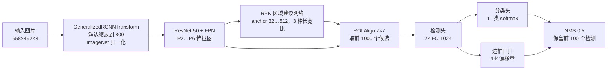

<div align="right">

[English](README.md) · **简体中文**

</div>

# 基于 Faster R-CNN 的瓶装白酒疵品检测


面向瓶装白酒灌装线表面**疵品检测**的目标检测项目：瓶盖破损、瓶盖变形、瓶盖坏边、
瓶盖打旋、瓶盖断点、标贴歪斜、标贴起皱、标贴气泡，以及喷码正常 / 喷码异常，共 **10 类缺陷**。

检测器为 Faster R-CNN + ResNet-50 FPN 骨干（41.1 M 参数），从 COCO 预训练权重微调而来。
本仓库提供**完整可运行**的流程：数据划分、训练、无第三方依赖的 COCO mAP 评估、可视化、
批量推理和网页演示，并给出所发布权重在**独立测试集**上的**实测**结果。

[项目简介](#-项目简介) · [实验结果](#-实验结果) · [数据集](#-数据集) · [快速开始](#-快速开始) · [命令行](#-命令行) · [原理](#-原理) · [复现说明](#-复现说明)

---

## 🔍 项目简介

人工目检是高速灌装线上的瓶颈：一个瓶子的判定时间只有零点几秒，而「瓶盖破损」与
「瓶盖坏边」这类缺陷在视觉上极为接近。本项目让一个标准的两阶段检测器在一次前向传播中
同时完成**定位与分类**。

| | |
|---|---|
| **任务** | 多类别目标检测（定位 + 分类） |
| **模型** | Faster R-CNN，ResNet-50 + FPN 骨干，41.1 M 参数 |
| **输入** | 658 × 492 彩色图像，短边缩放到 800 px |
| **类别** | 10 类缺陷 + 1 个保留的背景槽位 |
| **数据集** | 4,516 张图像 / 6,945 个标注框（70 / 20 / 10 划分） |
| **框架** | PyTorch 2.2 · torchvision 0.17 · Python 3.8+ |
| **参考硬件** | NVIDIA RTX 3050 Laptop（4 GB），CUDA 12.1 |
| **测试集 mAP@0.50** | **0.319** · mAP@[.50:.95] 0.170 · 单张 138 ms |

---

## 🖼 演示

网页演示同时回答两个问题：**「这个瓶子有什么问题」**和**「这个判断到底对不对」**——
样例图片自带标注框，可以把预测结果和真实标注直接对照。


```bash
python app/app.py --port 5000     # 浏览器打开 http://127.0.0.1:5000
```

测试集上的真实预测（彩色为预测，白色为真实标注）：


---

## 📊 实验结果

以下全部由 `src/evaluate.py` 在 **452 张测试集**（训练期间从未参与）上实测得到，一条命令即可复现：

```bash
python -m src.evaluate --checkpoint saved_models/model.pth \
    --output-dir outputs/eval_checkpoint --save-predictions
```

该权重是 Release 附件（见第 4 步），下面的数字由它实测得到。

### 汇总指标

| 指标 | 数值 | 含义 |
|---|---|---|
| **mAP@0.50** | **0.319** | 10 类在 IoU 0.50 下的平均 AP |
| mAP@0.75 | 0.156 | 更严格的定位要求 |
| mAP@[.50:.95] | 0.170 | COCO 主指标 |
| 置信度 0.50 时的精确率 | 0.630 | 模型给出 135 个框，85 个正确 |
| 置信度 0.50 时的召回率 | 0.155 | 549 个真实缺陷只找到 85 个 |
| F1 | 0.249 | |
| 图像级完全匹配率 | 0.374 | 预测的类别集合与标注完全一致的图片占比 |
| 推理速度 | 138 ms/张 | batch 1，RTX 3050 Laptop 4 GB，452 张共 63 s |

这组精确率/召回率是当前权重最诚实的概括：**一旦它给出判断，通常是准的；但大多数缺陷它不吭声。**
这是召回问题，不是定位问题——看下面的分类别表格会更清楚。

### 分类别结果


| # | 类别 | 英文名 | 训练集 | 验证集 | 测试集 | AP@0.50 | AP@[.50:.95] |
|---|---|---|---|---|---|---|---|
| 1 | 瓶盖破损 | `cap_cracked` | 1,135 | 334 | 150 | 0.000 | 0.000 |
| 2 | 瓶盖变形 | `cap_deformed` | 487 | 132 | 86 | 0.192 | 0.058 |
| 3 | 瓶盖坏边 | `cap_edge_broken` | 459 | 135 | 62 | 0.127 | 0.044 |
| 4 | 瓶盖打旋 | `cap_swirl` | 338 | 96 | 46 | 0.777 | 0.540 |
| 5 | 瓶盖断点 | `cap_dot_missing` | 422 | 123 | 69 | 0.145 | 0.025 |
| 6 | 标贴歪斜 | `label_skew` | 137 | 33 | 16 | 0.666 | 0.282 |
| 7 | 标贴起皱 | `label_wrinkled` | 296 | 70 | 18 | 0.000 | 0.000 |
| 8 | 标贴气泡 | `label_bubble` | 319 | 86 | 38 | 0.000 | 0.000 |
| 9 | 喷码正常 | `code_normal` | 344 | 101 | 44 | 0.476 | 0.234 |
| 10 | 喷码异常 | `code_defect` | 136 | 43 | 20 | 0.807 | 0.513 |

读这张表比只看汇总数字重要：

* **有三类分数为 0.000，而它们在测试集里各自都有几十到上百个标注框**
  （瓶盖破损 150、标贴起皱 18、标贴气泡 38）。该权重在任何置信度下都没有为这三类输出过
  任何一个框——分类头塌陷到了视觉上更容易区分的类别上。COCO 规则下这类记 AP = 0；
  如果把这三类「跳过不计」，mAP@0.50 会被算成 **0.399**，而真实值是 0.319。
* 表现好的类别（喷码异常 0.807、瓶盖打旋 0.777、标贴歪斜 0.666）都是与瓶身对比度高的目标。
* 658 × 492 下的小尺寸、低对比度缺陷已接近当前输入分辨率的上限——把 `--min-size`
  提到 1000 以上是最值得先试的一步。

### 精确率-召回率曲线


---

## 🗂 数据集

4,516 张图像、6,945 个标注框、10 类缺陷，分辨率为 658 × 492。数据划分固定并随仓库版本管理
（seed 42）：

| 划分 | 图像数 | 标注框数 | 占比 |
|---|---|---|---|
| 训练集 | 3,161 | 4,868 | 70 % |
| 验证集 | 903 | 1,405 | 20 % |
| 测试集 | 452 | 672 | 10 % |

COCO 标注格式、图片目录结构、以及「为什么 260 MB 原图不入库（只提交 60 张均衡样例）」，
详见 **[data/README.md](data/README.md)**。

标注上有两点需要知道：

* 标注文件里存在 `category_id = 0` 的真实类别「背景」（1,170 个框）。torchvision 检测器把
  标签 0 保留为分类器的背景槽，这一类永远学不到，因此在本项目所有指标中都被排除；
* 框的格式是 COCO 的 `[x_min, y_min, width, height]`；
* 部分图片在存储时被旋转了 90°，数据增强流程可以容忍，但在演示页里看得出来。

---

## 🚀 快速开始

### 1. 克隆与安装

```bash
git clone https://github.com/wushaw1102/Bottled-liquor-defect-detection-based-on-FasterR-CNN.git
cd Bottled-liquor-defect-detection-based-on-FasterR-CNN

python -m venv .venv
# Windows
.venv\Scripts\activate
# macOS / Linux
source .venv/bin/activate

# 按显卡驱动选择对应的 CUDA 版本（见 pytorch.org）
pip install torch torchvision --index-url https://download.pytorch.org/whl/cu121
pip install -r requirements.txt
```

### 2. 检查环境

```bash
python -c "import torch, torchvision; print(torch.__version__, torchvision.__version__, torch.cuda.is_available())"
# 2.2.0+cu121 0.17.0+cu121 True
```

### 3. 校验数据

```bash
python scripts/prepare_dataset.py \
    --annotation-file data/annotations/instances_all.json \
    --image-dir data/images --verify-only
```

该命令会打印每个划分的类别分布，并报告缺失图片。测试集应当显示
`452 images | 672 annotations`，且没有任何 `!!` 开头的告警。

> 还没有 `data/images`？仓库自带的 60 张样例在 `data/sample/images`。下面所有命令都可以
> 换成 `--image-dir data/sample/images --annotation-file data/sample/annotations.json`，
> 先跑通全流程再上全量数据。

### 4. 下载已发布权重

165 MB 的权重以 **Release 附件**形式发布——它超过了 GitHub 单文件 100 MB 的限制，
因此不在 Git 历史里：

```bash
mkdir -p saved_models
curl -L -o saved_models/model.pth \
  https://github.com/wushaw1102/Bottled-liquor-defect-detection-based-on-FasterR-CNN/releases/download/v1.0.0/model.pth
```

也可以直接在浏览器里从 [v1.0.0 Release](https://github.com/wushaw1102/Bottled-liquor-defect-detection-based-on-FasterR-CNN/releases/tag/v1.0.0) 下载。
自己训练（第 8 步）同样可以，把 `--checkpoint` 指向自己的权重即可。

### 5. 单张推理

```bash
python -m src.predict --image data/sample/images/img_0026692.jpg --threshold 0.4
```

```
img_0026692.jpg               2 detections | code_defect(0.58), code_normal(0.47)
wrote outputs/predictions/detections.json
wrote outputs/predictions/detections.csv
```

带框的图片会写到 `outputs/predictions/`。加 `--chinese` 用中文标签，用 `--input-dir`
可以批量跑一个文件夹。

### 6. 复现基准结果

```bash
python -m src.evaluate --checkpoint saved_models/model.pth \
    --output-dir outputs/eval_checkpoint
```

预期输出：

```
mAP@[.50:.95] : 0.1697
mAP@0.50      : 0.3189
mAP@0.75      : 0.1565
P / R / F1 @ 0.5: 0.6296 / 0.1548 / 0.2485
```

**不需要 `pycocotools`**：AP 由 `src/metrics.py` 计算，采用与 COCO 一致的 101 点插值。

### 7. 重新生成本文所有图表

```bash
python -m src.visualize \
    --metrics outputs/eval_checkpoint/metrics.json \
    --checkpoint saved_models/model.pth \
    --output-dir docs/images --gallery-count 6 --montage
```

### 8. 从零训练

```bash
python -m src.train --epochs 10 --batch-size 4 --lr 5e-4 --output-dir outputs/run1
```

4 GB 显存在 800 px 下放不下默认 batch，请用：

```bash
python -m src.train --epochs 10 --batch-size 2 --min-size 600 --workers 4
```

在 RTX 3050 Laptop 上实测 **1.1 s/步 ≈ 26 分钟/轮 ≈ 10 轮约 4.5 小时**。训练会把
`best_model.pth`（验证损失最低）、`last_model.pth`、`history.json` 和 `run_config.json`
写入 `--output-dir`。

### 9. 评估自己的权重

```bash
python -m src.evaluate --checkpoint outputs/run1/best_model.pth --output-dir outputs/eval_run1
```

### 10. 启动演示

```bash
python app/app.py --checkpoint outputs/run1/best_model.pth --port 5000
```

可以上传图片、拖拽图片，或直接点一张内置样例；拖动置信度滑块可以观察精确率与召回率的权衡；
勾选「叠加真实标注」即可对照预测与标签。

---

## 🛠 命令行

| 命令 | 作用 | 常用参数 |
|---|---|---|
| `python -m src.train` | 从 COCO 权重微调 | `--epochs --batch-size --lr --min-size --amp/--no-amp --patience --resume --limit-train` |
| `python -m src.evaluate` | COCO mAP + P/R/F1 + PR 数据 | `--checkpoint --score-threshold --limit --save-predictions` |
| `python -m src.predict` | 出图 / 导出框坐标 | `--image --input-dir --threshold --chinese --json` |
| `python -m src.visualize` | AP 柱状图、PR 曲线、样例拼图 | `--metrics --history --checkpoint --montage` |
| `python app/app.py` | 网页演示 | `--port --threshold --device --checkpoint` |
| `scripts/prepare_dataset.py` | 划分并校验 COCO 文件 | `--train --val --seed --drop-background --verify-only` |
| `scripts/make_sample.py` | 重建样例子集 | `--count --per-class` |

`src.train` 与 `src.evaluate` 都支持 `--arch fasterrcnn_mobilenet_v3_large_fpn`，
骨干轻 4 倍，可在纯 CPU 上跑，适合笔记本或没有显卡的容器。

---

## 📁 目录结构

```
.
├── src/                        可导入的包，无副作用的脚本逻辑
│   ├── config.py               类别表、路径、超参（唯一事实来源）
│   ├── dataset.py              COCO 数据集 + 框随图同步的增强
│   ├── model.py                Faster R-CNN 构建、权重加载
│   ├── metrics.py              无依赖的 COCO AP / mAP / PR
│   ├── train.py                微调循环（AMP、早停、history）
│   ├── evaluate.py             基准测试，写 metrics.json
│   ├── predict.py              单图 / 文件夹推理，导出 CSV + JSON
│   ├── visualize.py            画框、AP 柱状图、PR 曲线、样例拼图
│   └── inference.py            CLI 与演示共用的 Detector 封装
├── app/
│   ├── app.py                  Flask 演示（上传、样例、阈值滑块）
│   └── templates/index.html    自包含页面，不依赖 CDN，无需构建
├── scripts/
│   ├── prepare_dataset.py      数据划分 + 完整性校验
│   └── make_sample.py          从测试集生成 data/sample
├── data/
│   ├── annotations/            instances_{all,train,val,test}.json
│   ├── sample/                 60 张样例 + 对应标注
│   └── README.md               数据格式与目录说明
├── docs/images/                本文所有图表（均由脚本生成）
├── saved_models/model.pth      发布的权重（165 MB，从 Releases 下载）
├── legacy/original_scripts/    重构前的原始代码，留档备查
└── outputs/                    训练记录、指标、预测结果（已 gitignore）
```

---

## 🧠 原理



**为什么用两阶段检测器。** 这些缺陷都长在同一个宿主物体上：瓶盖要么完好要么开裂，标贴要么
平整要么起皱。单阶段检测器必须在每个 anchor 上一次性判断清楚；Faster R-CNN 先用 RPN 提候选，
再通过 ROI Align 把每个候选单独放大到 7×7、送进 1024 维全连接头做二次判断。对于
「100 px 瓶盖旁边 40 × 60 px 的裂纹」这种小目标，这次「二次观察」是值得的。

**损失函数。** 分类交叉熵 + smooth-L1 边框回归，各用两次：一次在 RPN 的候选上，一次在最终检测头上。

**指标是怎么算的**（`src/metrics.py`）：

1. 逐图、逐类别，按置信度排序后做贪心匹配（IoU 最大的未匹配标注优先）；
2. IoU ≥ 阈值（0.50 … 0.95）记为真正例；
3. 在整个划分上累加精确率/召回率，AP 取该曲线下 101 点插值面积；
4. mAP 为 10 类的平均值；有标注但一个框都没预测的类别记 0 分，划分中不存在的类别跳过。

---

## 🔬 复现说明

本仓库是对早期「三个脚本平铺」版本的重写。下面这些缺陷正是此前无法复现的原因，因此逐条记录：

| 原实现的问题 | 后果 | 本仓库的修复 |
|---|---|---|
| `RandomHorizontalFlip` / `RandomRotation` 只作用于图像，不改框 | 约一半训练样本的框落在图像的另一半 | `src/dataset.py` 中翻转时同步镜像框；去掉旋转（需要重算框，且会切掉边缘缺陷） |
| 数据集里 `Normalize` 一次，`GeneralizedRCNNTransform` 内部再归一化一次 | 每个输入被归一化两次，骨干网络偏离 COCO 权重的输入分布 | 数据集只输出 `[0, 1]`，模型内部归一化一次。已发布权重是按双重归一化训练的，`model.py` 把第二次归一化折入 transform（与原始激活误差 < 2e-6） |
| `split_dataset()` 把 `"annotations": data['annotations']` 写进了每个划分 | 验证/测试文件引用全部 6,945 个框，只有三分之一的图片：隐性标签泄漏 | `scripts/prepare_dataset.py` 让图片和框始终成对，发现不一致直接拒绝写文件 |
| 没有随机种子，`random.shuffle` 无 seed | 两次运行得到不同划分 | 全流程 seed 42，划分文件随仓库提交 |
| `cv2.imread` 读图 | 强依赖 OpenCV，文件缺失时直接崩 | 改用 Pillow，并给出明确报错与逐文件校验 |
| 没有验证指标、没有最优权重选择 | 无论效果如何都保存最后一轮 | 验证损失 + `best_model.pth` + `history.json` + 早停 |
| 损失/准确率图由两个独立脚本用硬编码（且互相矛盾）的数据生成 | 公布的曲线不对应任何一次真实训练 | 两个脚本已删除；本文所有图表都由 `src/evaluate.py` + `src/visualize.py` 基于本仓库权重实际计算 |

因此本文有两处数字与旧版不同：`mAP@0.50 = 0.319`（逐框计算的 COCO 指标）取代了定义模糊的
「准确率 0.76」；三个 AP 为 0 的类别被如实计入平均，而不是被排除在均值之外。

`saved_models/` 里的权重来自原始训练，本次**没有重新训练**——需要改的是代码去适配它的输入约定。
用修正后的增强与归一化重新跑 `src/train.py` 是下一步最值得做的事；`--min-size 1000` 与类别
均衡采样是最有可能救回那三个塌陷类别的两个改动。

---

## ❓ 常见问题

<details>
<summary><b>显存不足（CUDA out of memory）</b></summary>

Faster R-CNN 会把每张图短边缩放到 800，显存随 batch size 与 `--min-size` 增长，
与 JPEG 原始尺寸无关。4 GB 卡请用 `--batch-size 2 --min-size 600`，或改用
`--arch fasterrcnn_mobilenet_v3_large_fpn`。CUDA 下 `--amp` 默认开启。
</details>

<details>
<summary><b>完全检测不到目标 / mAP 为 0</b></summary>

按可能性排序：
1. 从零训练时没加 `--drop-background`，导致 17 % 的框要求分类器预测保留的背景标签；
   加上该参数，或直接使用已发布权重；
2. 你自己训练的权重不需要额外处理，但**旧版权重**需要：`model.py` 通过路径识别
   `saved_models/model.pth` 并自动补偿，所以移动它时请保持文件名；
3. 阈值太高——该权重是高精确率 / 低召回，0.5 阈值下只能找到 15 % 的缺陷。
   想观察行为可以降到 0.2，但这不是修复。
</details>

<details>
<summary><b>能在 CPU 上跑吗</b></summary>

可以：`--device cpu --arch fasterrcnn_mobilenet_v3_large_fpn`。小骨干约 1–2 s/张，
ResNet-50 会到 10 s 以上。
</details>

<details>
<summary><b>为什么数据集没有全部放进来</b></summary>

4,516 张图约 260 MB。仓库只提交了 60 张类别均衡的样例，保证 `git clone` 足够快。
把原图放进 `data/images/` 后所有命令都不用改——详见 [data/README.md](data/README.md)。
</details>

<details>
<summary><b>Windows 下 DataLoader 报错</b></summary>

在 `python -m src.train` 里用 `--workers 4` 是安全的（入口有 `__main__` 保护）；
自己写的脚本要么加 `if __name__ == "__main__":`，要么用 `--workers 0`。
</details>

<details>
<summary><b>怎么向非技术同事解释 0.319 的 mAP</b></summary>

「模型报出来的缺陷里，63 % 是真的；但真正存在的缺陷，它只报出了约 15 %。」
检测准不准和检测全不全，是两个问题，当前权重的问题是「不全」。
</details>

---

## 📄 许可

MIT，见 [LICENSE](LICENSE)。数据集图像来自作者产线采集，仅供研究使用。
